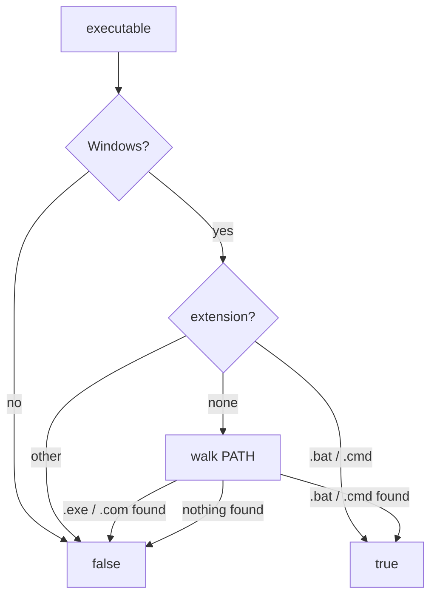

<!--
@license
Copyright (c) ggsuite

Use of this source code is governed by terms that can be
found in the LICENSE file in the root of this package.
-->

# Run Batch Commands Through the Shell on Windows

## Motivation

- gg runs checks before every commit, and they must work on every
  developer machine, Windows included.
- On Windows, the checks failed for Flutter repos when starting
  `flutter pub get --offline`, with the error
  "Das System kann die angegebene Datei nicht finden".
- The reason: Flutter, and dart from the Flutter SDK, exist on the PATH
  only as `flutter.bat` and `dart.bat`.
- `Process.run` of dart:io starts only `.exe` and `.com` files when no
  shell is used, so the batch files were never found.
- Goal: gg checks pass for Flutter repos on Windows, without touching
  every call site in the gg suite.

## Strategy

- Decide per executable whether it needs a shell to start.
- Put that decision into `GgProcessWrapper`, which all gg packages use to
  start processes.
- Keep the behavior on macOS and Linux unchanged.
- Test the decision with a fake platform and temporary PATH folders.
- Make the existing tests run in a plain Windows shell, not only in
  Git Bash.

## Implementation 1: needsShell

- New top-level function `needsShell(executable, {platform})` in
  `lib/src/gg_process_wrapper.dart`.
- Off Windows it returns false.
- Names ending in `.bat` or `.cmd` return true; other extensions false.
- Names without extension are looked up on the PATH. The variable name
  is matched case-insensitively.
- In each PATH directory, `.exe` and `.com` are checked first and return
  false; `.bat` and `.cmd` follow and return true.
- Unknown executables return false.

## Implementation 2: GgProcessWrapper

- `run` and `start` now pass
  `runInShell: runInShell || needsShell(executable)`.
- Callers that already ask for a shell keep it.
- This fixes every call site of the gg suite at once.

## Implementation 3: Tests

- New `test/gg_needs_shell_test.dart` uses a fake `GgPlatformDelegate`
  and temporary PATH folders to cover all branches.
- Existing tests ran `echo` directly. On Windows, `echo` is a cmd
  builtin; the tests had only passed under Git Bash, which ships an
  `echo.exe`.
- These tests now go through `test/echo.dart`, which uses `cmd /c echo`
  on Windows.

## Result

- `gg one can commit` passes for Flutter repos on Windows.
- The gg_process tests reach 100% coverage.

## Open Points

- None known.
